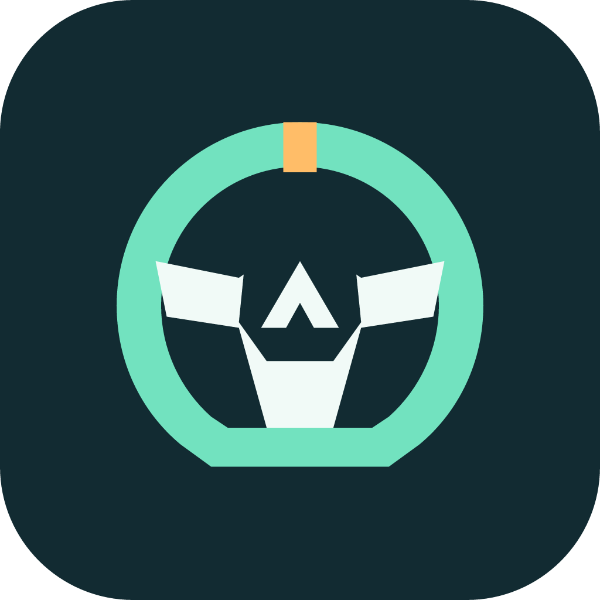

  

<h1 align="center">A9-Co-Driver（A9辅助驾驶）</h1>

面向 A9 国服的 Android 助手，在设备端识别游戏画面，通过无障碍服务执行选车、跑图和结算。

  <a href="https://github.com/funlee/A9-Co-Driver/releases/latest"><strong>下载 APK</strong></a> ·
  <a href="#快速开始">快速开始</a> ·
  <a href="#问题反馈">问题反馈</a> ·
  <a href="#功能说明">功能说明</a> ·
  <a href="#从源码构建">从源码构建</a>

## 快速开始

**手机无需 Root。** 支持 **Android 8.0 及以上**的设备或模拟器。首次使用可先启用一个任务、试跑一两局，确认赛事入口、选车和结算符合预期。

1. **安装。** 在 [GitHub Releases](https://github.com/funlee/A9-Co-Driver/releases/latest) 的 **Assets** 中下载 `.apk`。如果仓库要求登录，请使用有访问权限的 GitHub 账号。游戏需另行安装。
2. **开启权限。** 在「偏好设置」中开启「自动操作」，确认无障碍服务显示「已连接」。开启「比赛统计悬浮窗」可在游戏内查看统计并使用右侧 A9 控制按钮。
3. **选择游戏和任务。** 在「任务偏好」的「目标游戏」下拉框中选择已安装的游戏。进入「任务编排」，点击任务名称检查场次、车辆和赛事位置，启用要试跑的任务。 普通杯赛和每日战利品都使用「每日赛事」任务，按游戏里的每日赛事序号选赛。勾选「领取俱乐部奖励」后，识别到每日战利品时会检查并领取可用的俱乐部奖励。
4. **开始。** 点击「开始任务」（窄屏显示「开始」），同意系统截屏授权。助手会打开所选游戏并按队列执行。

### 屏幕分辨率

请以全屏横屏模式运行游戏。画面识别以国服 16:9 布局为基准，720×1280（横屏 1280×720）下像素校验最可靠。

非 16:9 比例下界面元素位置可能偏差，任务可能识别失败或误点，程序运行时会给出提示，强行运行本程序需自行承担后果。同一分辨率只提醒一次，改回标准分辨率不受影响。

## 问题反馈

使用中遇到问题，请提交 GitHub Issue，并附上以下信息。[前往 GitHub Issues](https://github.com/funlee/A9-Co-Driver/issues)

- 设备型号
- 程序版本、发生时间、设备分辨率、Android 版本、异常原因和现场截图。应用内的「偏好设置 → 问题排查」会按时间倒序显示最近 5 条异常，点开后可左右滑动查看。

## 鸣谢

- 感谢【a9赛事小助手-小程序】提供地图数据
- 感谢【Utopia Group】游戏车队提供部分地图代码以及内测支持
- 感谢【A9脚本】【无用脚本】提供方案、灵感
- 感谢【Codex】提供技术支持

## 许可证与资源

项目采用 [MIT 许可证](LICENSE)。
